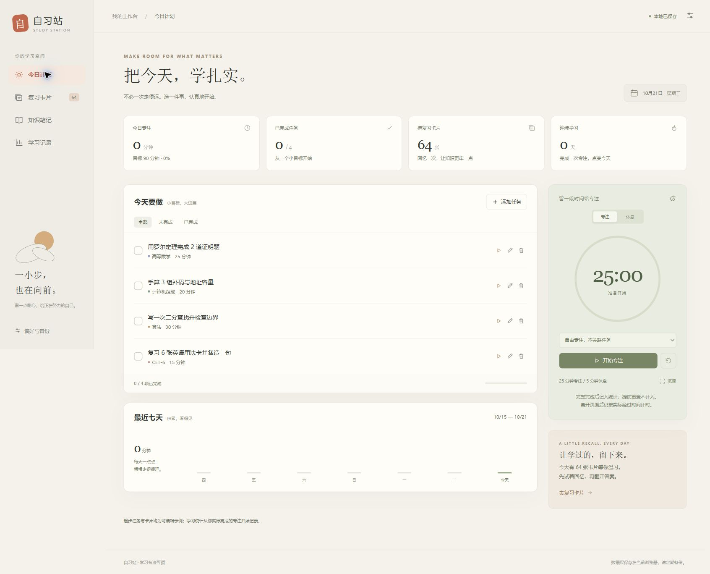

# 自习站 · Study Station

一个本地优先的学习工作台：把今天的任务、专注计时、复习卡片和知识笔记放在一起。

使用原生 HTML、CSS 和 JavaScript 编写，无运行时依赖、无需注册。学习数据保存在当前浏览器，不提供云端同步，也不包含分析统计或遥测服务。



## 功能

- **今日计划**：按日期安排任务、设置预计时长、勾选完成状态。
- **专注计时**：根据实际经过时间校准倒计时，支持暂停、继续、休息和沉浸模式；完整完成的专注才计入统计。
- **复习卡片**：内置高等数学、计算机组成、算法和 CET-6 共 64 张起步卡片，支持搜索、编辑和按回忆情况安排下次复习。
- **知识笔记**：自动保存学习笔记，将知识点或错因提炼成复习卡。
- **学习记录**：查看专注分钟数、最近七天的记录和连续学习天数。
- **备份与恢复**：导出 JSON 备份，通过文件或粘贴文本恢复，支持最大 5 MB 的备份。

起步任务、卡片和笔记均为可编辑示例，不代表使用者的学习历史。复习排期使用简单规则：忘记后约 1 分钟复习，其他评价按当前间隔延长；它不是 FSRS 或 SM-2 实现。

## 开始使用

**单文件版**：下载 `自习站.html`，使用现代浏览器直接打开，无需联网或安装依赖。浏览器可能限制本地文件存储，具体数据保存行为取决于浏览器设置。

**源码预览**：需要 Node.js 18 或更新版本。在项目目录执行：

```sh
node preview.mjs
```

打开终端显示的本地地址。不要直接打开 `dist/index.html`，浏览器对本地模块文件的限制可能阻止应用启动。

**重新生成单文件版**：

```sh
node package-offline.mjs
```

**运行核心测试**：

```sh
node --test tests/core.test.mjs tests/edgecases.test.mjs
```

核心逻辑包含 21 项测试。实际浏览器检查的范围与限制见[验证说明](docs/验证说明.md)。

## 数据与隐私

任务、笔记、卡片和专注记录使用浏览器 `localStorage` 保存。清理网站数据、使用隐私窗口、更换浏览器或移动离线文件，都可能使原数据不可见。在线部署、本地预览和离线文件的数据分别保存，迁移时请先导出备份。

备份包含笔记正文及学习记录。请把它当作个人数据保存，不要提交到公开仓库；也不要提交 `.env`、访问令牌、账号凭据或真实使用者的数据。导入备份会替换当前全部学习数据，操作前建议先导出当前备份。

更完整的数据处理说明见[隐私说明](PRIVACY.md)。

关闭页面期间不会发出计时提醒。重新打开后会按已保存的结束时间校准，完成专注不会自动勾选学习任务。

## 部署

将 `dist/` 内的文件发布到支持静态文件的托管服务即可，无需后端、数据库或部署密钥。使用 HTTPS 访问，并将数据备份到自己信任的位置。

## 文件

| 路径 | 内容 |
| --- | --- |
| `dist/` | 网页及学习示例源码 |
| `tests/` | 核心状态、计时、复习和备份测试 |
| `自习站.html` | 可直接打开的单文件版本 |
| `preview.mjs` | 本地预览服务器 |
| `package-offline.mjs` | 单文件打包脚本 |
| [24 题练习册](docs/24题练习册.pdf) | 四科各 6 道原创题、提示和解析 |
| [练习册文字版](docs/24题练习册.md) | 可编辑的练习内容 |

## 参与与许可

欢迎提交问题和改进。请先阅读[贡献说明](CONTRIBUTING.md)；安全问题的报告方式见[安全说明](SECURITY.md)。

本项目采用 [MIT 许可](LICENSE)。
